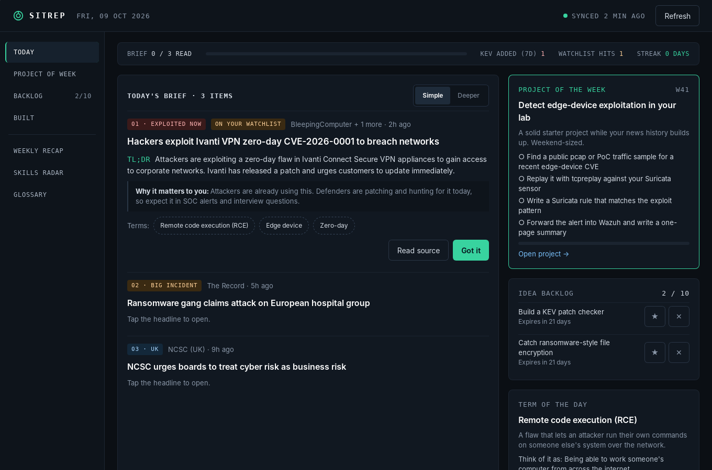

# Sitrep

**A calm, private daily cybersecurity brief for your desktop.**

Sitrep reads the main security news sources for you and gives you **three stories a day** in plain English, each with a two-sentence TL;DR and a line on why it matters to you. Around that sits a small learning loop: a term of the day, one quiz question, a weekly lab project built from the week's news, and an idea backlog that cleans itself up.

It's built for people who want to keep up with security without drowning in it, and who would rather spend the time building things in a home lab.



## Features

| | |
|---|---|
| **Daily brief** | Three stories a day, ranked: actively exploited flaws first, then major incidents, then UK news. Duplicates across sources are merged. |
| **Simple / Deeper** | Plain English by default. Switch to Deeper for CVE IDs, technique and technical detail. |
| **Jargon on tap** | Technical terms appear as chips that explain themselves in one line. A searchable glossary of 35 terms ships offline. |
| **Listen mode** | Reads the brief aloud with your operating system's built-in voice. |
| **Ask about a story** | Ask a follow-up question ("How would a SOC detect this?"). Needs the optional local AI. |
| **Project of the week** | Every Monday, the week's dominant theme becomes one weekend-sized lab project, with steps, tools and a clear "done when". Finished projects go to **Built**. |
| **Idea backlog** | Each brief adds lab ideas. Capped at 10, and ideas expire after 21 days unless starred. Dismissed ideas go to an archive you can restore from or delete. |
| **Watchlist** | Add vendors and tech you care about. Matching stories rank higher and get tagged. |
| **Quick check & weekly recap** | One question a day, plus a Sunday recap of the week's top themes with three questions. Missed terms come back later. |
| **Skills radar** | What the news covered in the last 30 days, compared with the themes you've built projects on. |

## Privacy

- **No account, no analytics, no telemetry, no tracking.**
- Your reading history, backlog, projects and watchlist are stored in a local SQLite database in your user profile.
- The only internet traffic is downloading six public feeds over HTTPS and, for the 3 daily stories, the full article from those same news sites (switchable in Settings). Both lists are in [`src-tauri/src/net.rs`](src-tauri/src/net.rs).
- The optional AI runs **on your own machine** through [Ollama](https://ollama.com). Ollama "cloud" models are blocked, so article text is never sent to a cloud AI.
- System fonts only, so no requests to font CDNs.

## Security

Sitrep treats every feed and every AI response as hostile input. In short:

- The UI has **no network, filesystem or shell access**. A strict Content Security Policy only lets it talk to the app's own Rust backend.
- All feed content is converted to **plain text** before storage, and the UI never renders HTML.
- Feeds are fetched over **HTTPS only**, from a **fixed allowlist**, with size and time limits and no cookies.
- Full articles are fetched only from the five news sites Sitrep already reads, and reduced to plain text before the AI sees them.
- Article links open only if they are plain `https://` links to a real domain.
- AI prompts **fence untrusted article text** behind random per-request markers, and AI output is validated as strict JSON and stripped to plain text.
- All database queries are parameterised.

Details: [threat model](docs/THREAT_MODEL.md), [security testing](docs/SECURITY_TESTING.md), [reporting a vulnerability](SECURITY.md).

## Install (Windows)

1. Go to [Releases](../../releases) and download the latest `Sitrep_x.y.z_x64-setup.exe`.
2. Run it. Windows SmartScreen may warn that the app is unrecognised, because the installer isn't code-signed yet. Choose **More info → Run anyway**.
3. Open Sitrep from the Start menu. It fetches the news on first launch.

### Optional: local AI for better summaries

Sitrep works without AI and uses each source's own summary. For plain-English rewrites, the Deeper view and Ask:

1. Install Ollama from [ollama.com](https://ollama.com).
2. Run `ollama pull llama3.2:3b` in a terminal (about 2 GB, one time).
3. Restart Sitrep, or click **Settings → Check again**.

A machine with 8 GB+ RAM is recommended. Larger models (e.g. `llama3.1:8b`) give better summaries if your PC can run them, and you can pick one in Settings.

## Build from source

Requirements: [Node.js 20+](https://nodejs.org), [Rust (stable)](https://rustup.rs), and the [Tauri prerequisites](https://v2.tauri.app/start/prerequisites/) for your OS (on Windows: Microsoft C++ Build Tools and WebView2, which is preinstalled on Windows 10/11).

```bash
npm ci
npm run tauri dev        # run in development
npm run tauri build      # build the installer (src-tauri/target/release/bundle)
```

Tests and checks:

```bash
npm test                                  # UI tests, including XSS and code guardrails
cd src-tauri && cargo test                # backend tests, including attack cases
cargo clippy --all-targets -- -D warnings
cargo audit && npm audit
```

## Project layout

```
src/                 React + TypeScript UI (renders text only; no network access)
src-tauri/src/
  net.rs             The only network code: HTTPS allowlist, limits, link checks
  feeds.rs           RSS/Atom and CISA KEV parsing into bounded plain text
  text.rs            HTML stripping, control-character removal, truncation
  store.rs           SQLite storage (parameterised queries only)
  core.rs            Brief ranking, backlog, projects, quiz, recap, radar
  ai.rs              Local Ollama client, prompt fencing, output validation
  commands.rs        The UI ↔ backend bridge, with input validation
  glossary.rs        Built-in plain-English glossary
  themes.rs          Story categories, lab ideas and weekly project templates
docs/                Architecture, threat model, security testing
```

More detail is in [docs/ARCHITECTURE.md](docs/ARCHITECTURE.md).

## Roadmap

- macOS build
- Code-signed Windows installer
- System tray and a morning notification
- Optional cloud AI (bring your own key, stored in the OS keychain)
- Export a finished project as a GitHub-ready write-up

## Credits

News comes from BleepingComputer, The Record, The Hacker News, the UK NCSC, the SANS Internet Storm Center and the CISA Known Exploited Vulnerabilities catalogue. Sitrep links to the original articles and doesn't republish them.

## License

[MIT](LICENSE) © 2026 Samuel Woniowei
